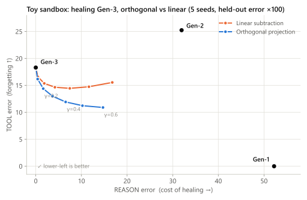
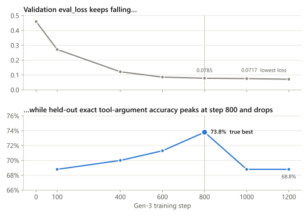
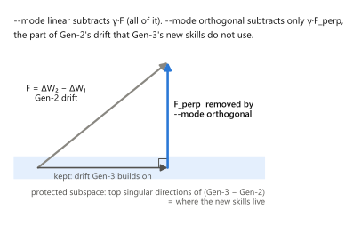
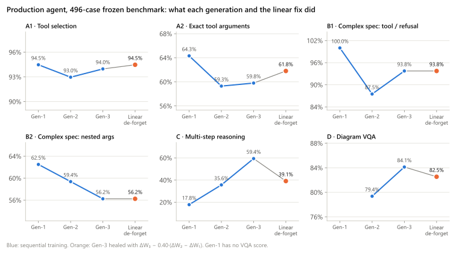

# lora-surgeon

**CPU-native GGUF & Safetensors LoRA weight surgery in $O(d \cdot r^2)$ — Continual de-forgetting via Thin QR-SVD and Frobenius-orthogonal subspace projection.**

[](LICENSE)
[](https://www.python.org/downloads/)
[](pyproject.toml)
[](https://github.com/duy232633786-dot/lora-surgeon/actions/workflows/ci.yml)

`lora-surgeon` is a lightweight, single-file research toolkit and CLI for diagnosing, merging, converting, and **healing catastrophic forgetting across sequential LoRA generations** (`Gen-1 → Gen-2 → Gen-3`) — operating **directly on `llama.cpp` `.gguf` and HuggingFace PEFT `.safetensors` adapters on a standard CPU in seconds**, without downloading the multi-gigabyte base model, without a GPU, and without PyTorch.

## Try It in 15 Seconds (Reproducible, No Download)

The production numbers further down come from a private model and benchmark, so you can't rerun them. This toy experiment you **can** rerun. It trains three sequential LoRA generations in pure numpy, makes them forget in the same way, then heals Gen-3 with `lora-surgeon`:

```bash
git clone https://github.com/duy232633786-dot/lora-surgeon && cd lora-surgeon
pip install -e .
python examples/toy_continual_forgetting.py
```

How the sandbox works: there are 8 modules with `r = 16`. A fixed low-rank "world" teacher defines two tasks, **TOOL** and **REASON**, whose input subspaces partly overlap.
- **Gen-1** trains on TOOL only.
- **Gen-2** warm-starts from Gen-1 and trains on REASON level 1 at a high learning rate.
- **Gen-3** warm-starts from Gen-2 and trains on full REASON at a lower learning rate, with no TOOL replay.

<picture>
  <source media="(prefers-color-scheme: dark)" srcset="docs/figures/tradeoff-dark.svg">
  
</picture>

The table shows held-out relative squared error ×100, averaged over 5 seeds (lower is better):

| Adapter | TOOL error | REASON error | TOOL vs Gen-3 | REASON vs Gen-3 |
|---|---:|---:|---:|---:|
| Gen-1 | 0.00 | 52.21 | −18.31 | +52.21 |
| Gen-2 | 25.24 | 31.94 | +6.93 | +31.94 |
| Gen-3 | 18.31 | 0.00 | 0.00 | 0.00 |
| `--mode linear` γ=0.2 | 15.37 | 1.86 | −2.94 | +1.86 |
| `--mode linear` γ=0.4 | 14.45 | 7.45 | −3.86 | +7.45 |
| `--mode linear` γ=0.6 | 15.55 | 16.76 | −2.76 | +16.76 |
| **`--mode orthogonal` γ=0.2** | **14.40** | **1.63** | **−3.91** | **+1.63** |
| **`--mode orthogonal` γ=0.4** | **11.93** | **6.54** | **−6.38** | **+6.54** |
| **`--mode orthogonal` γ=0.6** | **10.90** | **14.72** | **−7.41** | **+14.72** |

What the sandbox shows, and where it stops:
- At every γ, the **orthogonal projection beats linear subtraction on both axes**: it recovers more TOOL and costs less REASON. This also holds for `--protect-energy` 0.70–0.95 and for `--rank 8`.
- **Healing is not free.** Every setting gives back some REASON. Weight-space surgery moves you along a trade-off curve; it does not recover Gen-1 tool skill for free.
- **If Gen-3 already recovered** (try `--replay 0.05`), de-forgetting only adds error. Run `lora-surgeon diff` and evaluate before you operate.
- This is a linear toy where forgetting comes only from shared LoRA factors. It is not evidence about any particular LLM.

All figures in this README are produced by `pip install -e ".[plots]" && python examples/make_figures.py`. The trade-off chart is recomputed from the toy run; the production charts plot the tables below.

The script also writes `examples/toy_out/gen{1,2,3}.gguf`, so you can run the CLI on real files:

```bash
lora-surgeon diff examples/toy_out/gen1.gguf examples/toy_out/gen2.gguf examples/toy_out/gen3.gguf
lora-surgeon deforget --v1 examples/toy_out/gen1.gguf --v2 examples/toy_out/gen2.gguf \
  --v3 examples/toy_out/gen3.gguf --mode orthogonal --gamma 0.4 -o examples/toy_out/healed.gguf
```

---

## Why This Exists: A Real-World Continual SFT Post-Mortem

Most model-merging literature (*Task Arithmetic*, *TIES*, *DARE*, *WiSE-FT*) studies **parallel** adapters fine-tuned independently from a shared base checkpoint $W_0$:

$$W_A = W_0 + \Delta W_A, \qquad W_B = W_0 + \Delta W_B$$

In production AI engineering, however, teams rarely train isolated parallel branches forever. Instead, models evolve **sequentially across generations** (`Gen-1 → Gen-2 → Gen-3`), warm-starting each LoRA adapter from the previous generation's best checkpoint to accumulate capabilities over time.

### Three Phenomena Observed Across Sequential Generations

We studied a 4B-parameter hybrid-attention multimodal agent (`r = 64, α = 64`, 128 adapted linear projections across 32 layers, 70+ structured tool schemas, ~6,600 prompt tokens per turn) trained sequentially across three generations and evaluated on a **496-case frozen acceptance benchmark**:

1. **`Gen-1` (Clean Tool-Use Baseline):** Strong function selection (`94.5%`) and strict schema argument accuracy (`64.3%`), zero false-positive calls on out-of-scope constraints (`100%` on multi-constraint spec tasks), but limited multi-step quantitative reasoning (`17.8%`).
2. **`Gen-2` (Modality-Imbalanced / Truncated Update):** Trained under a 12 GB VRAM budget with ~40% visual tokens and higher learning rate (`5e-5`). Quantitative reasoning doubled (`17.8% → 35.6%`) and diagram VQA reached `79.4%`, **but structured tool-calling regressed sharply** (`64.3% → 59.3%`), with the model hallucinating plausible-sounding parameter enums that did not exist in the catalog.
3. **`Gen-3` (Full-Scale Continual SFT from `Gen-2`):** Trained for 12+ hours (`lr = 2e-5`, 138M tokens) starting from `Gen-2`. Quantitative reasoning surged (`35.6% → 59.4%`) and diagram VQA improved (`79.4% → 84.1%`), **yet `Gen-3` still failed strict regression gates against `Gen-1`** because `Gen-2`'s forgetting scar remained embedded in the adapter weights.

#### Phenomenon 1: The `eval_loss` Mirage & Token Signal Dilution

<picture>
  <source media="(prefers-color-scheme: dark)" srcset="docs/figures/evalloss-dark.svg">
  
</picture>

During `Gen-3` training, we tracked both standard validation cross-entropy (`eval_loss`) and live greedy tool-call generation on a held-out 80-case development split every 100 steps:

| Training Step | Held-Out Tool Name Acc. | Held-Out Exact Arg Acc. | Validation `eval_loss` | Checkpoint Verdict |
|---:|---:|---:|---:|---|
| 0 (`Gen-2` init) | — | — | 0.4600 | — |
| 100 | 80 / 80 (100.0%) | 55 / 80 (68.8%) | 0.2722 | — |
| 400 | 80 / 80 (100.0%) | 56 / 80 (70.0%) | 0.1218 | — |
| 600 | 80 / 80 (100.0%) | 57 / 80 (71.3%) | 0.0858 | — |
| **800** | **80 / 80 (100.0%)** | **59 / 80 (73.8%)** | **0.0785** | **True Best** |
| 1000 | 80 / 80 (100.0%) | 55 / 80 (68.8%) | 0.0760 | Overfitting |
| 1200 | 80 / 80 (100.0%) | 55 / 80 (68.8%) | **0.0717** | **Lowest Loss (-5.0% Args)** |

**Why did `eval_loss` decrease monotonically from step 800 to 1200 while exact argument accuracy dropped by 5 percentage points?**
Token accounting across structured tool-calling samples revealed extreme gradient dilution:
- Average forward sequence length: **6,636 tokens** (`28.6%` system instructions, `69.7%` tool JSON schemas, `1.7%` conversation).
- Supervised assistant tokens with active loss: **70.7 tokens** (`1.1%` of sequence), mostly repetitive XML/JSON framing (`<tool_call>`, `<function=...>`, `<parameter=...>`).
- **Discriminative parameter-value tokens** (the exact enum/identifier deciding pass vs. fail): **2.63 tokens** (`3.7%` of supervised tokens, or **1 / 2,500** of total forward compute).

#### Phenomenon 2: Trajectory Geometry in Low-Rank Weight Space

Inspecting the three sequential adapters ($\Delta W_1, \Delta W_2, \Delta W_3$) across all 128 adapted modules revealed two striking geometric properties:

| Quantity | Value | Geometric Interpretation |
|---|---:|---|
| $\|\Delta W_1\|_F$ | `15.5620` | `Gen-1` clean tool-calling adapter norm |
| $\|\Delta W_2\|_F$ | `16.2898` | `Gen-2` adapter norm |
| $\|\Delta W_3\|_F$ | `17.0885` | `Gen-3` adapter norm |
| $\|\delta_{1 \to 2}\|_F = \|\Delta W_2 - \Delta W_1\|_F$ | `4.9538` | `Gen-2`'s high-LR step (`5e-5`) moved further than `Gen-3`! |
| $\|\delta_{2 \to 3}\|_F = \|\Delta W_3 - \Delta W_2\|_F$ | `4.6608` | `Gen-3`'s recovery + reasoning step (`2e-5`) |
| $\cos(\delta_{1 \to 2},\; \delta_{2 \to 3})$ | `+0.1063` | Globally near-orthogonal steps in $\mathbb{R}^{d_{\text{out}} \times d_{\text{in}}}$ |
| Coordinate sign opposition $\mathbb{P}[(\delta_{1 \to 2})_{ij}(\delta_{2 \to 3})_{ij} < 0]$ | **`47.09%`** | Nearly half of all weight coordinates in `Gen-3` were actively reversing `Gen-2` drift |
| Rank-64 SVD energy retention of $\Delta W_1 \oplus \Delta W_2 \oplus \Delta W_3$ | **`99.97%`** | Sequential LoRA updates remain tightly confined to a shared rank-64 subspace |

---

## Mathematical Formulation & Algorithms

### 1. Exact $O((d_{\text{out}} + d_{\text{in}}) r^2)$ Trace-Factored Diagnostics

Materializing dense $\Delta W = \frac{\alpha}{r} B A \in \mathbb{R}^{d_{\text{out}} \times d_{\text{in}}}$ matrices across 128+ layers of modern LLMs wastes gigabytes of RAM and tens of seconds on CPU. Given any two low-rank sums $\Delta W_1 = B_1 A_1$ (rank $R_1$) and $\Delta W_2 = B_2 A_2$ (rank $R_2$), `lora-surgeon` computes exact Frobenius inner products via cyclic trace permutation:

$$\langle B_1 A_1,\; B_2 A_2 \rangle_F = \mathrm{tr}(A_1^\top B_1^\top B_2 A_2) = \mathrm{tr}\!\Big(\underbrace{(B_1^\top B_2)}_{R_1 \times R_2} \underbrace{(A_2 A_1^\top)}_{R_2 \times R_1}\Big)$$

Differences $\Delta W_2 - \Delta W_1 = [B_2, -B_1][A_2^\top, A_1^\top]^\top$ are evaluated identically at rank $R_1 + R_2$, requiring **zero $d_{\text{out}} \times d_{\text{in}}$ allocations** and running in `< 2s` on CPU.

### 2. Exact Thin QR-SVD Compression in $O((d_{\text{out}} + d_{\text{in}}) R^2)$

Suppose we form a linear or projected combination of $m$ adapters:

$$\Delta W_{\text{comb}} = \sum_{i=1}^m c_i B_i A_i = \mathbf{B}\mathbf{A}, \qquad \mathbf{B} \in \mathbb{R}^{d_{\text{out}} \times R},\; \mathbf{A} \in \mathbb{R}^{R \times d_{\text{in}}},\; R = \sum_{i=1}^m r_i$$

Instead of running a dense $O(d_{\text{out}} d_{\text{in}} \min(d_{\text{out}}, d_{\text{in}}))$ SVD, we compute reduced thin QR factorizations of both tall-skinny factors:

$$\mathbf{B} = Q_B R_B \quad (Q_B \in \mathbb{R}^{d_{\text{out}} \times R}), \qquad \mathbf{A}^\top = Q_A R_A \quad (Q_A \in \mathbb{R}^{d_{\text{in}} \times R})$$

and decompose only the tiny $R \times R$ core matrix ($R \le 192$):

$$M = R_B R_A^\top = \hat{U} \Sigma \hat{V}^\top \in \mathbb{R}^{R \times R}$$

Since $Q_B$ and $Q_A$ have strictly orthonormal columns, $(Q_B \hat{U}) \Sigma (\hat{V}^\top Q_A^\top)$ is **mathematically identical to the exact full-matrix SVD** of $\Delta W_{\text{comb}}$ (verified to $\sim 2 \times 10^{-7}$ relative float32 error in `--self-test`), while running **~500× faster**. Truncating to target rank $r$ with balanced singular-value scaling yields a drop-in rank-$r$ adapter:

$$B_{\text{new}} = Q_B \hat{U}_{:, :r} \Sigma_{:r}^{1/2}, \qquad A_{\text{new}} = \Sigma_{:r}^{1/2} \hat{V}_{:, :r}^\top Q_A^\top$$

### 3. Why Linear Task Arithmetic Hurts Reasoning — and How Frobenius-Orthogonal Projection Fixes It

To undo `Gen-2`'s forgetting $\delta_{\text{forget}} = \Delta W_2 - \Delta W_1$ while keeping `Gen-3`'s upgrade $\delta_{\text{new}} = \Delta W_3 - \Delta W_2$, natural trajectory de-forgetting writes:

$$\Delta W_{\text{linear}}(\gamma) = \Delta W_3 - \gamma\,(\Delta W_2 - \Delta W_1) = \Delta W_2 + 1.0\,\delta_{\text{new}} - \gamma\,\delta_{\text{forget}}$$

Unlike naive interpolation $(1 - \lambda)\Delta W_3 + \lambda \Delta W_1$ (which shrinks $\delta_{\text{new}}$ by $1 - \lambda$), $\Delta W_{\text{linear}}(\gamma)$ preserves `1.0x` of $\delta_{\text{new}}$. **However**, in sequential continual learning, `Gen-3`'s reasoning representations build *on top of* intermediate features first introduced in `Gen-2` ($\delta_{\text{forget}}$ and $\delta_{\text{new}}$ share non-trivial principal subspaces). Subtracting $\gamma\,\delta_{\text{forget}}$ globally inadvertently removes the foundational subspace that `Gen-3`'s reasoning relies on!

#### Exact Factored Frobenius-Orthogonal Projection

<picture>
  <source media="(prefers-color-scheme: dark)" srcset="docs/figures/projection-dark.svg">
  
</picture>

Let $\delta_{\text{new}} = U \Sigma V^\top$ be the thin QR-SVD of the latest capability update, and let $U_k \in \mathbb{R}^{d_{\text{out}} \times k}, V_k \in \mathbb{R}^{d_{\text{in}} \times k}$ span the top-$k$ singular directions capturing fraction $\tau \in [0, 1]$ (default `0.85`) of $\|\delta_{\text{new}}\|_F^2$. Define the protected matrix subspace:

$$\mathcal{S}_k = \big\{ U_k C V_k^\top \;:\; C \in \mathbb{R}^{k \times k} \big\}$$

Notice an important subtlety: two-sided null-projection $(I - U_k U_k^\top) F (I - V_k V_k^\top)$ is **over-restrictive** — it annihilates not only $\mathcal{S}_k$, but also the valid cross-subspace components $U_k U_k^\top F (I - V_k V_k^\top)$ and $(I - U_k U_k^\top) F V_k V_k^\top$. The **exact** minimal Frobenius-orthogonal projection of $F = B_f A_f$ onto $\mathcal{S}_k^\perp$ is:

$$F^{\perp} = F - U_k \big(U_k^\top F V_k\big) V_k^\top = B_f A_f - \underbrace{\Big[U_k (U_k^\top B_f)(A_f V_k)\Big]}_{B_{\text{proj}} \in \mathbb{R}^{d_{\text{out}} \times k}} \underbrace{V_k^\top}_{A_{\text{proj}} \in \mathbb{R}^{k \times d_{\text{in}}}}$$

**Properties:**
1. **Exact Orthogonality:** $\langle F^{\perp},\; U_k C V_k^\top \rangle_F = 0$ for *every* $C \in \mathbb{R}^{k \times k}$ (verified to $< 5 \times 10^{-5}$ in `--self-test`).
2. **Minimum Perturbation:** Among all matrices orthogonal to $\mathcal{S}_k$, $F^{\perp}$ is the unique closest matrix to $F$ in Frobenius norm, with $\|F^{\perp}\|_F^2 = \|F\|_F^2 - \|(U_k^\top B_f)(A_f V_k)\|_F^2$.
3. **Pure $O(d \cdot r^2)$ Low-Rank Execution:** Since $F^{\perp}$ is a rank-$(2r + k)$ factored sum, $\Delta W_{\text{orth}} = \Delta W_3 - \gamma F^{\perp}$ feeds directly into Thin QR-SVD with **zero dense matrix allocation**.

Combined with **Module Role Separation** (`--gamma-attn` vs. `--gamma-mlp`), stronger recovery can be targeted at attention projections (`q/k/v/o_proj`, which govern tool routing and span copying) while keeping MLP projections (`gate/up/down_proj`, which store domain knowledge and mathematical procedures) conservatively protected.

---

## Experimental Results & Ablation Study

### 1. Controlled Dev Ablation Across 5 Weight-Surgery Formulations

Before running the full 496-case acceptance suite, we compared five rank-64 QR-SVD weight-surgery formulations on a strictly held-out validation slice covering structured tool selection, exact parameter synthesis, abstention/refusal, and multi-step quantitative reasoning:

| Method | Formula $(\Delta W_1, \Delta W_2, \Delta W_3)$ | SVD Energy (`r=64`) | Tool Selection | Exact Args | Refusal | Multi-Step Reasoning |
|---|---|---:|---:|---:|---:|---:|
| **`Gen-3` Baseline** | `(0.00, 0.00, 1.00)` | `100.00%` | `100.0%` | `60.0%` | `50.0%` | **`37.5%`** |
| **Linear LoRA Soup (`WiSE-FT`)** | `(0.35, 0.00, 0.65)` | `99.98%` | `100.0%` | `70.0%` | **`62.5%`** | `25.0%` *(diluted)* |
| **Hybrid Soup + De-Forgetting** | `(0.45, -0.20, 0.75)` | `99.97%` | `100.0%` | `70.0%` | **`62.5%`** | `25.0%` *(diluted)* |
| **Damped Trajectory** | `(0.55, -0.43, 0.88)` | `99.95%` | `100.0%` | `70.0%` | **`62.5%`** | `12.5%` *(collapsed)* |
| **Coordinate Sign-Consensus** | Elementwise sign mask + SVD | `99.74%` | `100.0%` | `60.0%` | **`62.5%`** | `25.0%` |
| **Trajectory De-Forgetting** | **`(0.40, -0.40, 1.00)`** | **`99.97%`** | **`100.0%`** | **`75.0% (+15%)`** | `50.0%` | **`37.5%` (preserved)** |

**Key Takeaway:** Any formulation that scales $\Delta W_3$ below `1.0` (`0.65`, `0.75`, or even `0.88`) immediately degrades multi-step quantitative reasoning, whereas keeping `1.0 * ΔW_3` and subtracting `0.40 * (ΔW_2 - ΔW_1)` lifted held-out exact parameter accuracy by **+15.0 percentage points** without hurting dev reasoning.

### 2. Full 496-Case Frozen Benchmark Evaluation (and Evidence of Subspace Entanglement)

<picture>
  <source media="(prefers-color-scheme: dark)" srcset="docs/figures/generations-dark.svg">
  
</picture>

Evaluating the global linear trajectory de-forgetting adapter (`ΔW_3 + 0.40(ΔW_1 - ΔW_2)`, synthesized on CPU in `17.3s` with `99.97%` mean SVD energy retention) across the complete 496-case frozen acceptance suite revealed both the power and the exact theoretical boundary of uniform linear surgery:

| Evaluation Suite (496 Frozen Cases) | `Gen-1` | `Gen-2` | `Gen-3` | Locked Gate (`max(G1,G2)`) | **Linear De-Forget (`γ=0.40`)** | Change vs `Gen-3` |
|---|---:|---:|---:|---:|---:|---:|
| **A1. Core Agent — Tool Selection** | **188**/199 | 185/199 | 187/199 | 188/199 | **188 / 199 (94.5%)** | **+1 (Gate Passed)** |
| **A2. Core Agent — Exact Parameters** | **128**/199 | 118/199 | 119/199 | 128/199 | **123 / 199 (61.8%)** | **+4 (+44% gap closed)** |
| **B1. Complex Spec — Tool / Refusal** | **32**/32 | 28/32 | 30/32 | 32/32 | **30 / 32 (93.8%)** | 0 *(Gen-3 new error)* |
| **B2. Complex Spec — Nested Args** | **20**/32 | 19/32 | 18/32 | 20/32 | **18 / 32 (56.3%)** | 0 |
| **C. Multi-Step Quantitative Reasoning** | 36/202 | 72/202 | **120**/202 | 72/202 | **79 / 202 (39.1%)** | **−41 (Subspace Entanglement)** |
| **D. Technical Diagram VQA** | — | 50/63 | **53**/63 | 50/63 | **52 / 63 (82.5%)** | −1 *(Gate Passed)* |

**Why did Suite C drop from `120 → 79` even though $\delta_{2 \to 3}$ had weight `1.0`?**
Look at the progression of Suite C across generations: `36 (Gen-1) → 72 (Gen-2) → 120 (Gen-3)`. Half of the reasoning capability (`36 → 72`) was constructed *inside* $\delta_{1 \to 2} = \Delta W_2 - \Delta W_1$, and `Gen-3`'s `72 → 120` weights composed on top of those intermediate features. Uniformly subtracting `0.40 * (ΔW_2 - ΔW_1)` across all singular directions partially dismantled that shared reasoning foundation — motivating the **Frobenius-Orthogonal Projection (`--mode orthogonal`)** and **Attention/MLP Selective (`--gamma-attn` / `--gamma-mlp`)** operators:

- Across all 128 modules of our `r = 64` adapters on CPU, `--mode orthogonal` (`protect_energy = 0.80–0.90`) preserves **`93.99%–98.83%`** of the de-forgetting vector norm strictly orthogonal to `(Gen-3 - Gen-2)`'s dominant singular subspace while retaining **`99.984%–99.986%`** rank-64 SVD energy in `18.6s–63.9s`.

---

## Installation & Quickstart

```bash
pip install git+https://github.com/duy232633786-dot/lora-surgeon
# Or from a local clone (editable):
pip install -e .
```

Either way installs the `lora-surgeon` command. The `python lora_surgeon.py ...` form below is equivalent.

### 1. Inspect an Adapter's Layerwise Norm Profile (`.gguf` or `.safetensors`)

```bash
python lora_surgeon.py inspect Gen3-LoRA-F16.gguf
```

### 2. Run Exact $O(d \cdot r^2)$ Generational Trajectory Diagnostics

```bash
python lora_surgeon.py diff Gen1-LoRA.gguf Gen2-LoRA.gguf Gen3-LoRA.gguf
```

Output:
```text
Comparing 3 adapters across 128 shared modules (O(d*r^2) trace method):
  ||dW||_F [Gen1-LoRA.gguf] = 15.5620
  ||dW||_F [Gen2-LoRA.gguf] = 16.2898
  ||dW||_F [Gen3-LoRA.gguf] = 17.0885
  Step 1->2 ||dW_2 - dW_1||_F = 4.9538 (attn=1.4196, mlp=4.7460)
  Step 2->3 ||dW_3 - dW_2||_F = 4.6608 (attn=1.3111, mlp=4.4726)
  Trajectory Cosine(v2-v1, v3-v2) = +0.1063
```

### 3. Heal Continual Forgetting with Frobenius-Orthogonal Projection

```bash
# Protect 85% of (Gen3 - Gen2)'s spectral subspace while applying stronger
# recovery on Attention routing projections than on MLP knowledge blocks:
python lora_surgeon.py deforget \
  --v1 Gen1-LoRA.gguf \
  --v2 Gen2-LoRA.gguf \
  --v3 Gen3-LoRA.gguf \
  --mode orthogonal \
  --protect-energy 0.85 \
  --gamma-attn 0.50 \
  --gamma-mlp 0.25 \
  -o Gen3-Healed-LoRA-F16.gguf
```

You can also output directly to a HuggingFace PEFT directory (to use as a clean warm-start `--parent` checkpoint for `Gen-4` training!):

```bash
python lora_surgeon.py deforget \
  --v1 Gen1-LoRA.gguf --v2 Gen2-LoRA.gguf --v3 Gen3-LoRA.gguf \
  --mode orthogonal -o ./checkpoints/gen3_healed_peft/
```

### 4. Multi-Adapter Thin QR-SVD Merge & Bidirectional Format Conversion

```bash
# Exact rank-64 SVD merge of arbitrary weighted adapters:
python lora_surgeon.py merge \
  --inputs adapter_a.gguf=0.35 adapter_b.gguf=0.65 \
  --rank 64 -o merged.gguf

# Convert between llama.cpp GGUF LoRA and HuggingFace PEFT safetensors without PyTorch:
python lora_surgeon.py convert ./peft_checkpoint_dir -o adapter-f16.gguf
python lora_surgeon.py convert adapter-f16.gguf -o ./peft_restored_dir
```

---

## Verification

Run the built-in mathematical verification suite (checks trace inner-product exactness, Thin QR-SVD vs. dense SVD equivalence, and Frobenius orthogonality of $F^{\perp}$ against $\mathcal{S}_k$):

```bash
python lora_surgeon.py --self-test
pytest
```

## License

MIT License. See [LICENSE](LICENSE).
